# ENTROPY HELIOS (v1.3.4 Beta)

**Standalone Dual-Core 8-Voice Ambient Drone & Microtonal Synthesizer for the M-VAVE FM-1**

> **[Launch WebMIDI Hardware Studio](https://behn1220.github.io/entropy-helios/entropy-helios-studio.html)** &nbsp;•&nbsp; **[Flash FM-1 via Browser (v1.3.4)](https://behn1220.github.io/entropy-helios/entropy-helios-1.3.4.html)** &nbsp;•&nbsp; **[Interactive Website](https://behn1220.github.io/entropy-helios/)** &nbsp;•&nbsp; **[Full Hardware Manual](docs/ENTROPY-HELIOS-MANUAL.md)**

---

## Flagship Hardware WebMIDI Studio (Zero Install)

Plug your M-VAVE FM-1 into Chrome or Edge via USB-C and launch the **[Entropy Helios WebMIDI Studio](https://behn1220.github.io/entropy-helios/entropy-helios-studio.html)** for complete two-way tactile control over the entire synthesizer:

[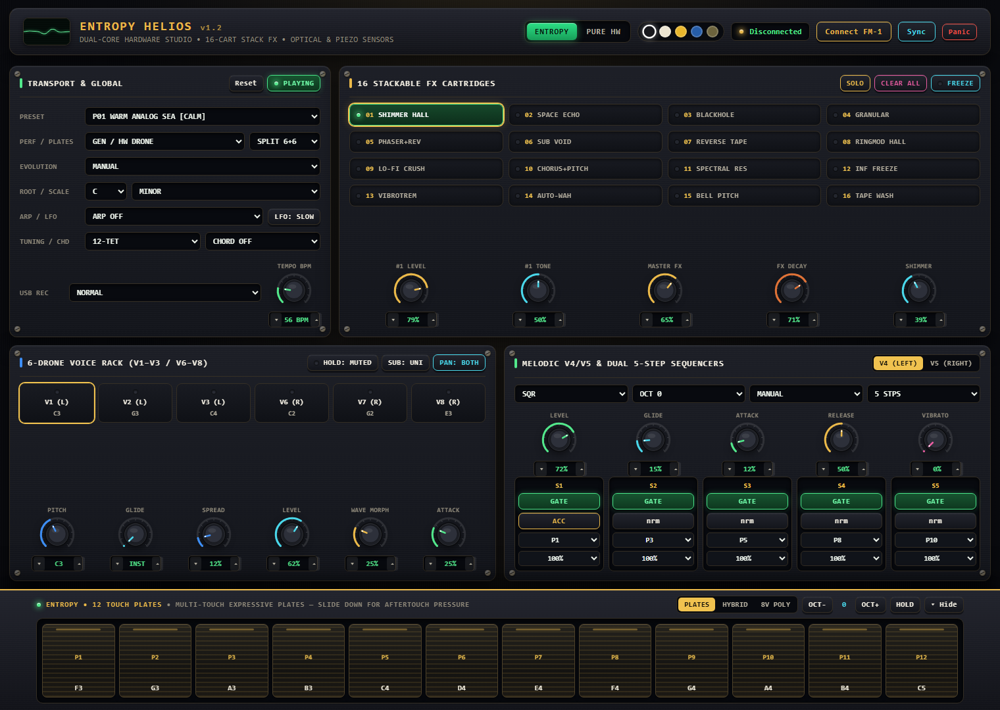](https://behn1220.github.io/entropy-helios/entropy-helios-studio.html)

### Modular Bay, Dual Analog VCFs, 3D Spring Joystick & Optical/Piezo Sensors

[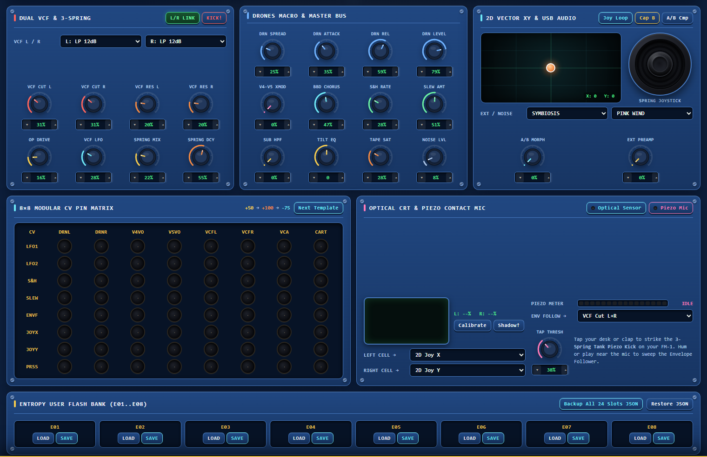](https://behn1220.github.io/entropy-helios/entropy-helios-studio.html?theme=cobalt)

### 5 Matching Color Themes (Synced Live to the FM-1 Screen)

| Vintage Cream | Amber Yellow |
| :---: | :---: |
| [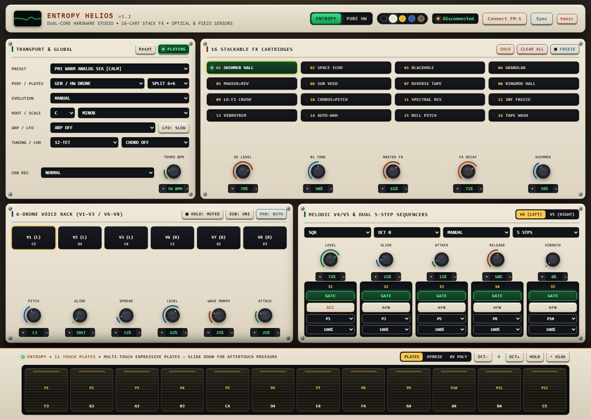](https://behn1220.github.io/entropy-helios/entropy-helios-studio.html?theme=cream) | [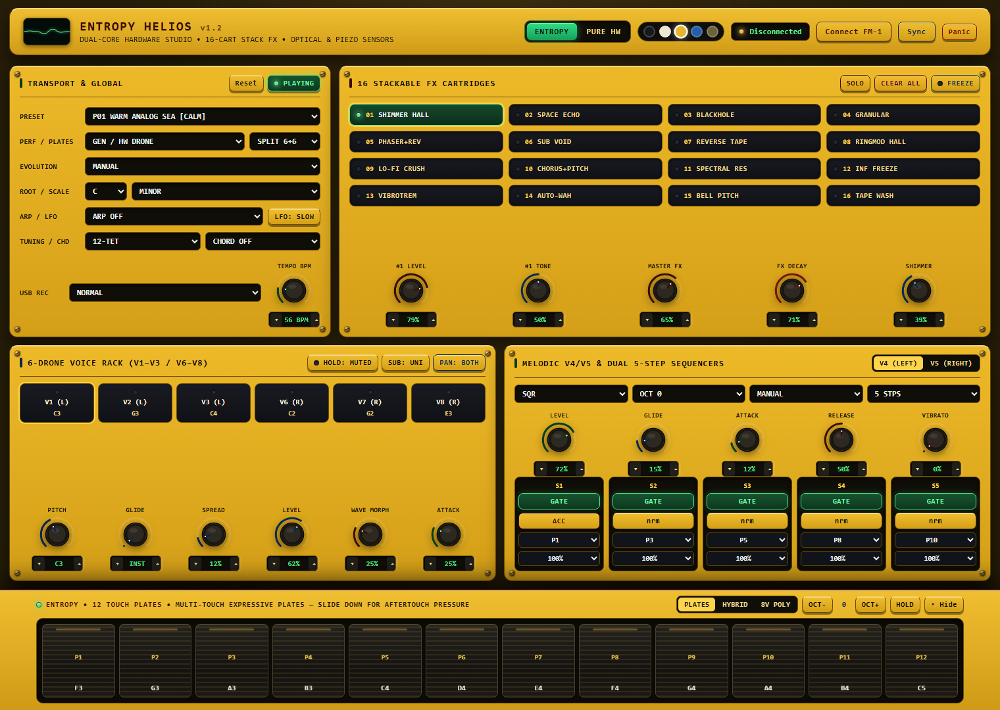](https://behn1220.github.io/entropy-helios/entropy-helios-studio.html?theme=amber) |

| Cobalt Blue | Tactical Olive |
| :---: | :---: |
| [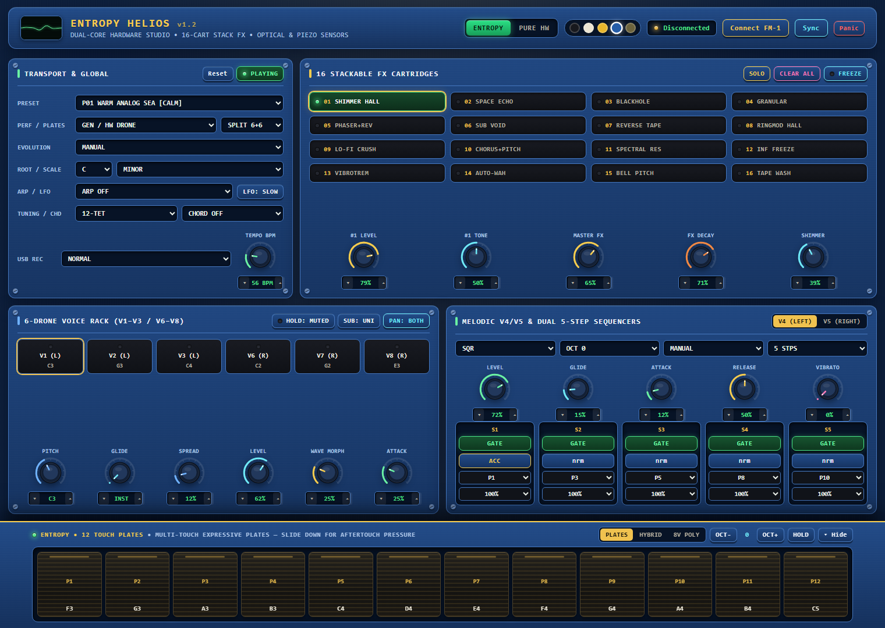](https://behn1220.github.io/entropy-helios/entropy-helios-studio.html?theme=cobalt) | [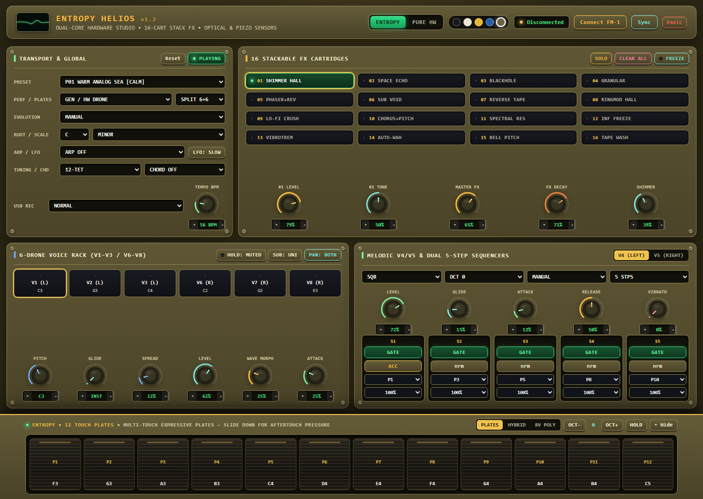](https://behn1220.github.io/entropy-helios/entropy-helios-studio.html?theme=olive) |

**What the WebMIDI Studio Does:**
- **Full Two-Way SysEx Sync**: Hit `Sync` to pull 100% of knobs, 6 drone voices (including per-drone Glide), dual 5-step sequencers, 16 stacked FX cartridges, 8×8 CV pins, and `ENTROPY` / `PURE HW` state live from your FM-1.
- **3D SVG Rotary Knobs & Spring-Return Vector Joystick**: Drag knobs smoothly, nudge with `▾`/`▴` steppers, or click any OLED value box to type exact values or note names (like `C3`).
- **Frozen Morphing Capacitive Keyboard Dock**: Switches live between **12 Touch Plates**, **Hybrid Split**, and **8V Poly** with rising pressure meters, latchable `HOLD`, `OCT-/+`, multi-touch, and desktop QWERTY play.
- **Webcam Optical Photoresistor & Desk-Tap Piezo Mic**: Wave your hand over your webcam to sweep filters or XY morph like dual analog photoresistors, or tap your desk near your microphone to physically kick the FM-1's 3-Spring Reverb Tank.
- **24-Slot Flash Patch Librarian**: Save, load, and back up all 8 Entropy user slots (`E01–E08`) and all 16 Pure HW slots (`H01–H16`) as a single `.json` file.

---

## FM-1 On-Device 240×240 Hardware UI (All 5 Color Themes)

Captured directly from Entropy Helios v1.2 firmware — every module button smoothly expands into full-screen tactile hardware views with 3D color-coded knobs, live filter curves, magnetic FX cartridges, and `ENT` / `PURE HW` badging:

| Home Console (Obsidian Black) | Drone Bank L (Amber Yellow) | Dual Analog VCF (Cobalt Blue) |
| :---: | :---: | :---: |
| 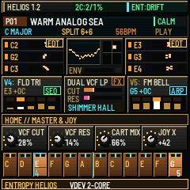 | 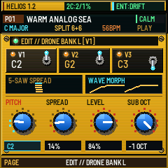 | 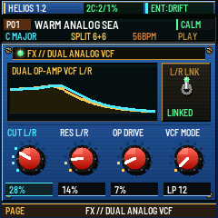 |

| 16-Cart Stack FX (Vintage Cream) | 8×8 CV Pin Matrix (Tactical Olive) | PURE HW Mode (`H01–H16`) |
| :---: | :---: | :---: |
| 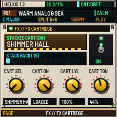 | 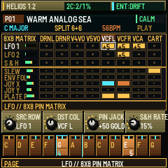 | 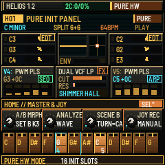 |

---

## Hardware Highlights

  

- **Two Top-Level Operating Modes (`SEL + REC` 1-Tap Toggle)**:
  - **`ENTROPY` Mode (Default at boot)**: Full generative ambient engine (`DRIFT` / `CINEMA` / `WILD`) with 18 handcrafted, radically diverse presets (`P01–P08 [CALM]`, `P09–P13 [LUSH]`, `P14–P18 [EDGE]`) + **8 Entropy User Slots (`E01–E08`)** starting as clean `INIT` templates.
  - **`PURE HW` Mode (Zero Entropy)**: All 18 generative presets disappear, leaving **16 dedicated Blank `INIT` Hardware Slots (`H01–H16`)** with zero autonomous drift — pure hands-on hardware patching from scratch.
- **Dual-Core Asymmetric SMP Engine (`Core 0` + `Core 1`)**: 6 swarm drone voices (30 oscillators) with per-drone adjustable Glide + 2 melodic voices + dual analog-modeled op-amp VCFs + 8-voice polyphonic play mode with velocity & per-key polyphonic aftertouch.
- **16 Stackable FX Cartridges + 3-Spring Tank**: Load any combination of 16 effects simultaneously (`SHIMMER HALL`, `SPACE ECHO`, `BLACKHOLE`, `GRANULAR`, `PHASER+REV`, `SUB VOID`, `REVERSE TAPE`, `RINGMOD HALL`, `LO-FI CRUSH`, `CHORUS+PITCH`, `SPECTRAL RES`, `INF FREEZE`, `VIBROTREM`, `AUTO-WAH`, `BELL PITCH`, `TAPE WASH`) with independent per-cartridge **Level** and **Tone**.
- **Full-Screen Tactile Hardware UI**: 5 anodized chassis finishes (`BLACK`, `CREAM`, `AMBER YEL`, `COBALT`, `OLIVE` — persisted to flash), 3D color-coded knobs, 360 ms expand/collapse module zoom animation, unmistakable `ENT` vs `PURE HW` header badging, and a live-animated P31 phosphor-green CRT boot splash.
- **Live USB Audio In FX, 3-Band Parametric Master EQ & Studio Recording**: Sculpt your final mix with a 3-band stereo parametric EQ (`ENV` 2nd page: Low Shelf, sweepable Mid Bell + Q, High Shelf with live frequency-response curve), route external stereo USB audio through the filters and 16 FX cartridges, and record at unity `0 dBFS` with click-free `SPK MUTE`.

## Hardware Compatibility (Both FM-1 Flash Chipsets Supported)

Entropy Helios v1.3.4 Beta supports **both M-VAVE FM-1 hardware revisions** out of the box—including full browser OTA flashing and permanent flash saves (`H01–H16` Pure HW slots, `E01–E08` Entropy user slots & chassis/global settings):

- **Puya P25Q80** (`JEDEC 85 60 14`, 1 MiB) — original stock FM-1 units
- **UC25HQ80** (`JEDEC B3 60 14`, 1 MiB) — newer FM-1 units (autumn 2026+ / AliExpress)

## Quick Start (Flash via Browser)

1. Open the **[v1.3.4 WebMIDI Flasher](https://behn1220.github.io/entropy-helios/entropy-helios-1.3.4.html)** (or `docs/entropy-helios-1.3.4.html` locally) in **Chrome** or **Edge**.
2. Connect your **M-VAVE FM-1** via USB-C and click **Install**.
3. Open the **[Entropy Helios WebMIDI Studio](https://behn1220.github.io/entropy-helios/entropy-helios-studio.html)** for live two-way control, patch backup, and optical/piezo sensors.
4. See [ENTROPY-HELIOS-MANUAL.md](docs/ENTROPY-HELIOS-MANUAL.md) for the complete control reference.

## Credits & License

Released under the **Mozilla Public License 2.0 (MPL-2.0)** — see [LICENSE](LICENSE).

Entropy Helios is built on top of open-source M-VAVE FM-1 community foundations (MPL-2.0):
- **Charles Vestal** — `fm1-base` platform framework, WebMIDI OTA installer, and `engine/dsp/fastmath.h` single-precision math library.
- **Leo Kuroshita (`@kurogedelic`, Hügelton Instruments)** — `felucca-bsp` hardware board support package and OTA tooling.
- **Laurens (`@profikid`)** — dual flash chipset support (`Puya P25Q80` + `UC25HQ80` in `fm1-base`).
- **Styves Goupil** — `engine/dsp/dsp.h` DSP helpers and `build.sh` build script template (from FRASIL).
