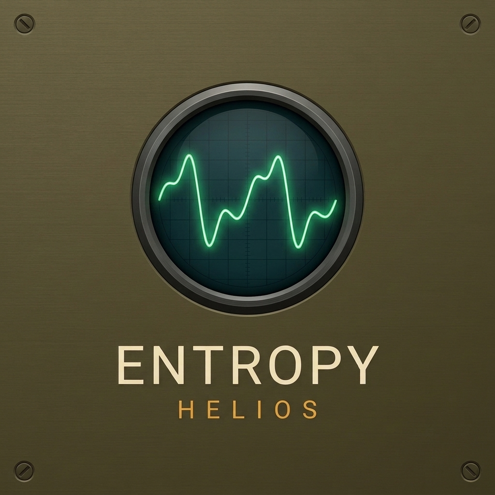

# ENTROPY HELIOS (v1.0 Beta)

**Standalone Dual-Core 8-Voice Ambient Drone & Microtonal Synthesizer for the M-VAVE FM-1**

## Highlights

- **Dual-Core Asymmetric SMP Engine (`Core 0` + `Core 1`)**: 6 swarm drone voices (30 oscillators) + 2 melodic voices + dual analog-modeled op-amp VCFs + 8-voice polyphonic play mode with velocity & per-key polyphonic aftertouch.
- **16 Stackable FX Cartridges + 3-Spring Tank**: Load any combination of 16 effects simultaneously (`SHIMMER HALL`, `SPACE ECHO`, `BLACKHOLE`, `GRANULAR`, `PHASER+REV`, `SUB VOID`, `REVERSE TAPE`, `RINGMOD HALL`, `LO-FI CRUSH`, `CHORUS+PITCH`, `SPECTRAL RES`, `INF FREEZE`, `VIBROTREM`, `AUTO-WAH`, `BELL PITCH`, `TAPE WASH`) with independent per-cartridge **Level** and **Tone**.
- **Full-Screen Tactile Hardware UI**: 5 anodized chassis finishes (`BLACK`, `CREAM`, `AMBER YEL`, `COBALT`, `OLIVE` — persisted to flash), 3D color-coded knobs, 360 ms expand/collapse module zoom animation, and a live-animated P31 phosphor-green CRT boot splash.
- **36 Mood-Grouped Presets + 8 User Flash Slots**: 20 warm analog `[CALM]` presets with automatic Analog Warmth Guard, 8 `[LUSH]` cinematic presets, 8 `[EDGE]` experimental presets, plus 8 writable flash slots (`U01–U08`).
- **Live USB Audio In FX & WebMIDI Studio**: Process external stereo USB audio through the filters, spring tank, and 16 stacked FX cartridges—plus a desktop & mobile **WebMIDI Studio** featuring an 8×8 CV Pin Matrix, 2D Vector Joystick, JSON user-bank backup, **Webcam Optical Photoresistor Sensor**, and **Desk-Tap Virtual Piezo Mic**.

## Quick Start (Flash via Browser)

1. Open `docs/entropy-helios-1.0.html` (or your live GitHub Pages site) in **Chrome** or **Edge**.
2. Connect your **M-VAVE FM-1** via USB-C and click **Install**.
3. Open `docs/entropy-helios-studio.html` for the live WebMIDI controller & optical/piezo sensors.
4. See [ENTROPY-HELIOS-MANUAL.md](docs/ENTROPY-HELIOS-MANUAL.md) for the complete control reference.

## Credits & License

Released under the **Mozilla Public License 2.0 (MPL-2.0)** — see [LICENSE](LICENSE).

Entropy Helios is built on top of open-source M-VAVE FM-1 community foundations (MPL-2.0):
- **Charles Vestal** — `fm1-base` platform framework, WebMIDI OTA installer, and `engine/dsp/fastmath.h` single-precision math library.
- **Leo Kuroshita (`@kurogedelic`, Hügelton Instruments)** — `felucca-bsp` hardware board support package and OTA tooling.
- **Styves Goupil** — `engine/dsp/dsp.h` DSP helpers and `build.sh` build script template (from FRASIL).
